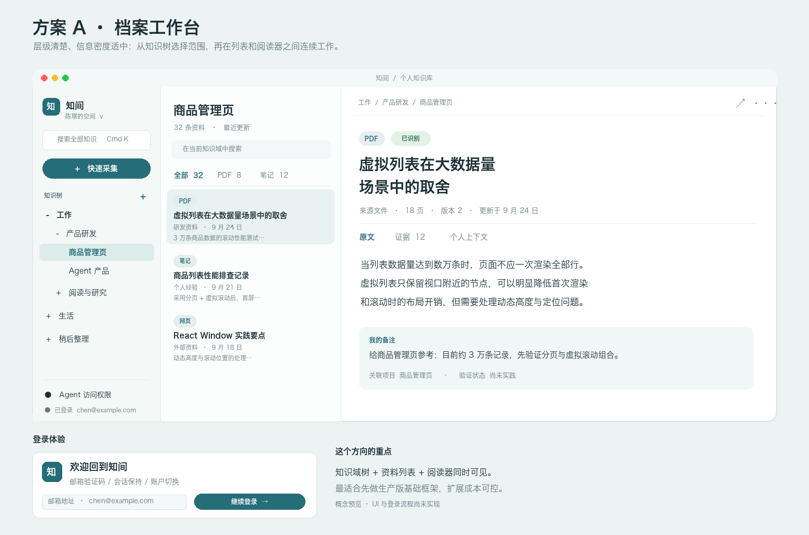
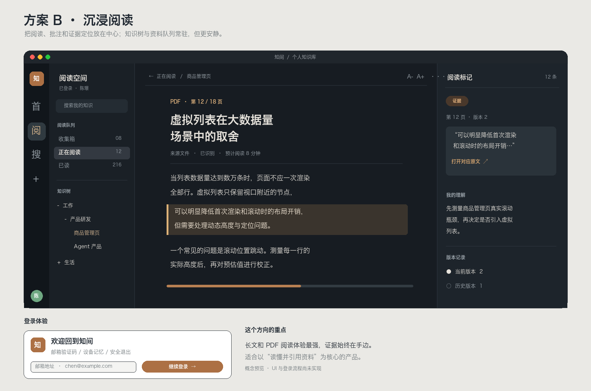
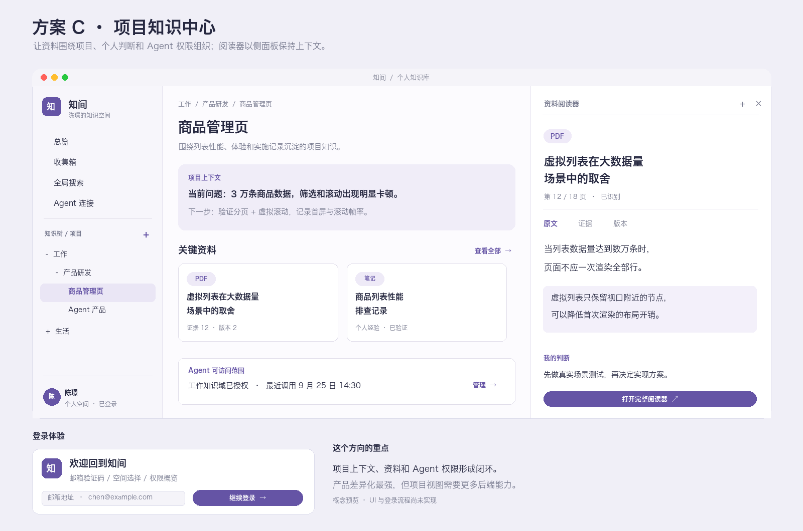

# Mac 客户端 v2：三套产品界面方向

状态：供选择的概念稿。预览图使用模拟资料，不代表功能已经实现。

## 共同产品骨架

三套方向都包含：正式账户登录与会话保持；知识域 → 项目 → 资料的知识树；全局搜索与快速采集；正文、PDF 文字、证据、版本和个人备注阅读；Agent 授权入口。知识树首期只表达已有知识域与项目关系，不暗示已支持任意层级文件夹。

真实流程应是：登录 → 选知识域或项目 → 搜索/打开资料 → 阅读原文和证据 → 补充个人判断 → 按知识域授权 Agent。采集后可直接进入刚保存的资料。

## A · 档案工作台（推荐作为首个生产版）

固定三栏：知识树、资料列表、阅读器。适合不断采集、分类、查找和核对资料的知识工作者；任何时刻能看清当前位置。登录后直接回到上次知识域，右侧正文支持原文/证据/个人上下文切换。最容易把现有 Mac 采集和检索功能迁入完整框架。代价是长篇阅读宽度有限，需要全屏阅读模式。

## B · 沉浸阅读

窄导航栏 + 阅读队列/知识树 + 宽正文 + 证据侧栏。PDF 页码、版本证据和个人理解始终靠近原文。适合“读懂、批注、再引用”是主要任务的用户。阅读体验最好；但资料管理和批量整理会比 A 多一次切换，实现原件 PDF 阅读及精确证据定位的成本也更高。

## C · 项目知识中心

知识树选择项目，主区域显示当前问题、关键资料、个人经验与 Agent 授权范围，右侧停靠阅读器。它最突出本产品的差异：公开资料如何转化为用户项目中的可用经验。适合围绕长期项目工作的用户；但项目上下文、关键资料编排和 Agent 调用摘要需要新增产品规则与后端接口，不宜只靠静态卡片伪装已具备的能力。

## 选择依据

| 维度 | A 档案工作台 | B 沉浸阅读 | C 项目知识中心 |
| --- | --- | --- | --- |
| 主任务 | 管理、检索、阅读 | 长文阅读、证据核对 | 项目决策、知识复用 |
| 信息架构 | 固定树 + 列表 + 阅读器 | 阅读队列 + 阅读器 + 证据 | 树 + 项目主页 + 侧面阅读器 |
| 与现有能力的贴合度 | 高 | 中 | 中低 |
| 新增实现量 | 中 | 中高 | 高 |
| 主要风险 | 三栏在小窗口拥挤 | 采集整理入口被弱化 | 项目主页数据不足时显得空 |

建议先选 A 作为壳层，同时吸收 B 的“阅读器全屏 + 证据侧栏”和 C 的“个人上下文/Agent 权限”模块。若产品战略要从资料管理转向阅读或项目决策，再分别以 B 或 C 为主轴。

## 与当前工程的差距

当前 Mac App 通过 Token/开发邮箱连接后台，尚无正式邮箱登录、验证码、会话刷新和账户切换。后端已有知识域、项目、资料、版本、证据与 Agent 授权接口，但 Mac 客户端没有项目导航；也没有任意层级的树节点模型。当前 PDF 阅读是提取文字与页码证据，不是原件 PDF 的完整页面阅读器。三套图中的登录与知识树、阅读器均为目标设计，不能以换皮完成。

## 参考

- [Notion：侧栏与嵌套页面](https://www.notion.com/help/navigate-with-the-sidebar)：借鉴层级导航和可收起的侧栏。
- [Readwise Reader：导航与阅读视图](https://docs.readwise.io/reader/docs/faqs/navigation)、[高亮与笔记](https://docs.readwise.io/reader/docs/faqs/highlights-tags-notes)：借鉴阅读时的侧栏、批注和定位。
- [Capacities：全页、预览与侧面板](https://docs.capacities.io/reference/navigation)：借鉴同一资料在主区域与侧面板之间切换。

预览的结构、视觉和文案均为本项目重新设计；没有使用参考产品的素材或标识。
