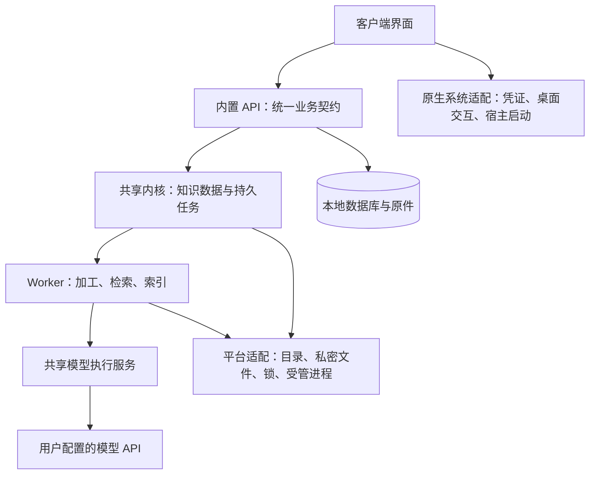

# 客户端内置模型与共享内核实施方案

日期：2026-10-20（Asia/Shanghai）。状态：按用户授权逐批实施中。批次进展和验收见 [实施记录](../verification/kernel-refactor-20261020/README.md)；本方案的目标和完成定义保持，未完成批次不能被描述为已经交付。

## 1. 目标与当前基线

本次围绕两件事：

1. 用户安装“知识收集箱.app”后，只需在设置中配置自己的模型API，无需额外启动网关、API或Worker。
2. 明确共享内核、客户端界面、系统适配层三部分边界。本轮完成macOS实现与契约，Windows／Linux保留接入位置，不交付对应客户端或声称其已通过验证。

### 核验得到的实际状态

| 项目 | 核验时状态 | 本次处理 |
| --- | --- | --- |
| 正式入口 | `apps/macos/dist/知识收集箱.app`，来源见 `apps/macos/release.json` | 保持唯一入口与候选→验收→发布 |
| 内置模型调用 | 已随2026-10-19模型配置版交付；2026-10-20阅读页版本沿用同一后台 | 基于已有实现完善，不重复建设 |
| 已有模拟验收 | 模型配置版记录228项回归，随包覆盖分析、问答、域概览三个调用点 | 作为历史基线，不能替代重构后的验收 |
| 内置执行方式 | `embedded_gateway.py` 每次调用新建FastAPI实例与临时事件循环 | 改为Worker生命周期稳定的执行服务 |
| 凭证 | Keychain保存，随后通过环境变量传Host及Worker | 收口到平台凭证存储与私有启动通道 |
| 平台边界 | Python业务已有复用基础，目录、锁、权限和进程管理含Unix/macOS依赖 | 抽取少量平台接口，业务规则保持 |
| 界面 | SwiftUI／AppKit，近期已有阅读页和采集页调整 | 保留现有界面及交互，不混入新的界面重设计 |

来源：[当前交付](../../apps/macos/release.json)、[直接模型配置验收](../verification/a1/model-config-acceptance-20261019.md)、[模型配置运行包](../verification/a1/runtime-model-config-20261019.json)。核验时正式运行包摘要为 `08923e76f569559a58b8524a05d95e1053e4dc10458a5fe0409348f85aefa4d0`，schema16、插件1.0.5。后续开始实施时须重新确认release及并行工作，不能覆盖后来的已交付修复。

## 2. 架构决策

### 2.1 进程模型

保持“桌面客户端＋内置API宿主＋Worker”的现有关系。模型执行服务放在Worker内，不增加独立网关监听端口或常驻守护进程。App退出时由宿主管理后台退出，恢复继续沿用任务检查点及未知结果保护。

外置开发网关可保留为高级兼容入口，和内置调用复用同一执行实现。普通用户不配置内部地址、内部访问凭证或端口。

### 2.2 三层职责

| 层 | 负责 | 不作为该层的职责 |
| --- | --- | --- |
| 共享内核 | 资料/版本/知识域/标签、采集归档、解析、AI计划与结果校验、RAG、索引、任务、权限、备份格式、MCP工具与授权规则 | 窗口排版、系统弹窗、钥匙串或Windows ACL的具体调用 |
| 客户端界面 | 输入与未提交草稿、阅读渲染、导航、页面缓存、确认、状态展示、阅读偏好 | 正式任务重试决策、结果有效性、授权过滤、模型提示词和知识持久化规则 |
| 系统适配层 | 目录、安全凭证、私密I/O、文件锁、进程、系统OCR、CLI及桌面集成 | 复制一套标签/RAG/分析业务规则 |

系统适配层是职责边界，按调用位置分别落在Python宿主和原生客户端中，不另建一个通用适配服务。依赖方向为“客户端通过契约使用内核，内核通过小型接口使用系统能力”；业务模块不导入Swift、AppKit或平台具体实现。

### 2.3 最小目录调整

- 现有业务继续保留在 `services/api/app` 与 `services/worker`，本轮不批量改名或搬迁全部模块。
- 在 `services/ai_gateway` 中抽出执行服务、提示词及供应商调用边界；`main.py` 保留可选HTTP入口，不承载唯一一份业务实现。
- 在 `services/api/app/platform_support/` 增加小型协议、平台选择和macOS实现；平台专用导入限制在对应实现内部。
- 原生侧将凭证、受管内核启动、桌面操作收敛到系统适配对象；原页面通过Model／API访问业务。
- 外部API路由与已有导入位置先保留兼容入口，再按批次替换内部调用。只为已有调用设计接口，不引入插件框架、容器框架或新的桌面技术栈。

## 3. 工作线A：完善内置模型执行

### A1. 统一执行服务

抽取一个供内置调用和HTTP适配器共同使用的模型执行服务，保留分析、问答、节点概览三种现有契约，统一管理：

- 提示词及版本、供应商参数、图文输入、响应解析与校验；
- 超时、取消、并发及容量限制、安全错误和用量；
- 请求编号、输入指纹和配置范围的幂等绑定。

Worker持有稳定实例；所需事件循环／网络客户端随实例创建和关闭。不能继续每次新建FastAPI或简单缓存App后每次 `asyncio.run`，避免幂等失效及跨事件循环Task问题。原有持久任务仍是重启恢复的依据，内存缓存不替代任务记录。

同类型、同配置、同request_id和同输入重复提交最多发送一次；同编号不同输入明确冲突。失败和未知结果不自动重复调用。跨重启的在途结果保持unknown，不把进程内缓存描述为跨重启恰好一次保证。

### A2. 模型配置与能力

- 普通设置提供服务商、API Key、文字模型、图片模型；基础URL和外置网关为高级项。
- 内核统一校验配置；区分文字、图片、结构化输出和输入预算等能力。当前优先保证已有DeepSeek及明确支持的兼容协议，不承诺任意接口都兼容。
- 保存配置只做本地校验；测试连接独立触发，界面明确其是免费健康检查还是会实际调用模型。健康就绪与真实模型可用分开显示。
- 无密钥、密钥读取被拒绝或模型不可用时，AI显示不可用，阅读、编辑、本地搜索、备份及只读MCP等基础能力继续启动。
- 仍只将已明确确认的内容发给模型，不因配置成功自动创建分析或测试任务。

### A3. 凭证和启动契约

平台CredentialStore负责保存、读取和删除，首批使用既有Keychain服务名，保留用户现有密钥；区分“没有凭证”“访问被拒绝”“暂不可用”。禁止静默降级为明文。

新增有版本、有大小上限的私有启动信封，通过受控管道传递启动所需信息。Host接收本地服务凭证，Provider Key仅交给执行AI的Worker；清理无关子进程环境，避免沿用整份环境向其他工具传递。Key不写入命令参数、普通配置、任务快照、数据库、备份、插件或日志；不要求跨平台凭证备份。

普通模型配置及设备级凭证引用采用有版本的设备配置存储，不随知识库备份导出。配置归属沿用当前物理本地库隔离，迁移时不擅自变成全局共享配置。

### A4. 配置变更与在途任务

用稳定 `profile_id` 与显式 `config_revision` 标识配置；凭证只使用引用和随机代次，不用密钥或密钥散列充当公开配置ID。新任务冻结模型、地址、能力、配置代次及必要的提示词／契约版本。

| 任务状态 | 修改配置时的行为 |
| --- | --- |
| 没有在途任务 | 安全应用新配置，更新内核状态 |
| 已排队、尚未发送 | 保留旧绑定；无法继续时暂停并提示重新确认，不改送新厂商 |
| 已发送 | 原调用按原配置完成；新配置等待安全切换，不靠重启杀掉调用 |
| 结果未知 | 保留未知状态，用户明确处理后才能创建新调用 |

切换、停用、清除密钥都经过内核的持久任务检查，不能只检查前端busy标志。第一版允许采用“排空后受控重启宿主”的简洁方案；是否存在任务、何时可以切换由内核判断，界面展示生效中／待切换／失败状态。

### A5. 保留已有图文和业务规则

图片指纹／版本绑定、未归档阻断、长图原像素切块、分段检查点、最终合成、引用与长度校验全部复用。无视觉能力时明确阻止图文调用，不忽略图片。原文、人工标签、有效产物及既有检索和权限规则不因内置化改变。

## 4. 工作线B：落实三层架构

### B1. 最小平台接口

| 能力 | 接口应保证的语义 | 当前要替换的依赖 |
| --- | --- | --- |
| Paths／RuntimeLayout | 数据/缓存/日志/配置/模型路径、解释器与资源定位 | `~/Library`、`python/bin/python3`等写死路径 |
| PrivateFiles／Locks | 私密读取写入、所有权验证、防链接、共享/独占锁、独占原子发布 | 分散的 `fcntl`、`O_NOFOLLOW`、getuid、chmod与原子目录操作 |
| OwnedProcesses | 启动、就绪、停止、超时、父进程退出回收 | pass_fds、信号、进程与管道管理 |
| CredentialStore | 保存/读取/删除及明确错误，不返回到普通业务视图 | Swift Keychain直接调用及凭证传递 |
| ExternalCapabilities | 受限CLI执行与系统OCR，统一输入输出和错误 | 飞书CLI路径、进程调用、Vision |
| DesktopIntegration | 文件选择、剪贴板、打开浏览器/文章、协议注册、通知 | AppKit及操作系统具体交互 |

平台层承诺安全语义，不能仅把 `flock` 重命名后让其他平台跳过校验。Windows／Linux本期只定义能力契约和布局设计，未实现的能力明确报不支持，不返回虚假成功。业务模块应可脱离macOS专用导入进行契约测试；这不代表对应系统已经能运行完整内核。

PaddleOCR／PDF文字解析属于共享处理能力；飞书图片的Apple Vision实现才通过系统OCR适配。重模型依赖采用延迟加载，缺少可选OCR或模型配置不应阻断基础阅读与搜索。

### B2. 客户端正式采集业务迁移

单独一批迁移，不与模型执行器或备份适配同时大改：

- 输入草稿、文件选择、待提交勾选和页面状态留客户端。
- 用户确认提交后，内核接管持久任务、原件暂存、幂等、已上传图片记录、重试和清理。UI只展示内核状态。
- 飞书授权交互留客户端；正文/XML版本对齐、图片清单、采集编排和归档进入内核，CLI执行通过适配层。
- 兼容当前Swift队列格式。旧队列迁入时使用稳定条目ID和迁移回执，事务确认后才清理旧暂存；中断可恢复，不丢原件或重复入库。
- 秘密与设备路径不随队列业务数据跨系统迁移。采用过渡兼容入口，先保留旧数据可读，再切换写入责任。

### B3. 客户端与内核契约

保留现有 `/v1` 业务接口和结构化错误。启动握手或既有只读健康能力新增兼容元数据：内核版本、契约版本、数据库版本、平台/架构及实际能力；不回传密钥。客户端以能力控制入口和提示，而非散落的操作系统判断。

结果是否当前有效、调用是否允许重试、资料是否授权等由内核决定。客户端保留当前20秒页面缓存、后台刷新、代次隔离与树状态，不能因为抽层重新引入快速切页闪烁。

MCP工具与只读授权留内核；可执行路径和配置写入落适配层。文章URL格式与权限校验保持，协议注册由各系统负责。调用模型不改变Agent只读访问的授权边界。

## 5. 分批实施与交付顺序

| 批次 | 工作内容 | 完成门槛 |
| --- | --- | --- |
| M0 基线与契约 | 冻结最新正式包/源码；核对原型与文档；定义配置、错误、启动、能力及平台接口 | 基线差异可追溯，测试范围和兼容清单明确 |
| M1 内置执行可靠性 | 共享执行服务、稳定实例、三个调用点、幂等/容量/未知保护 | 三种任务在内置和外置适配下规则一致，重复与异常用例通过 |
| M2 配置与凭证 | 平台凭证接口、私有启动信封、基础功能降级、任务级配置切换 | 无Key可启动；改配置不打断或改送在途请求；密钥不进入持久数据和日志 |
| M3 平台依赖隔离 | 目录、运行包、私密I/O/锁、进程、备份原子操作、MCP启动器 | macOS行为回归；业务层无平台专用导入；不支持能力明确失败 |
| M4 客户端业务收敛 | 已提交采集队列、飞书加工规则迁内核；UI统一读取状态 | 旧队列/部分上传/重启/重复提交/失败清理均正确，草稿与原件不丢失 |
| M5 完整验收与发布 | 同源运行包、随包闭环、真实模型质量、文档和唯一App发布 | 通过下述验收矩阵；release记录完整，正式入口唯一 |

依赖顺序：M0→M1→M2→M3→M4→M5；每批保留兼容入口并独立回归。平台边界审查和测试设计可并行，模型执行器、启动通道与队列迁移分批整合，避免多人同时改同一状态机。批次完成不等于整个计划完成。

## 6. 数据、兼容与升级

- 预计执行器抽取与平台接口不需要修改schema16。配置及任务绑定优先使用有版本的设备配置和兼容快照字段；如确需新增持久结构，先补迁移、备份和回退设计再实施，不能只修改版本常量。
- 旧外置网关模式、有效AI产物、标签与RAG历史继续可读。升级和刷新不触发模型调用。
- 旧任务若缺少新配置绑定，按旧逻辑URL和迁移标记保守处理；无法证明配置一致时暂停确认，不猜测重放。
- 旧队列迁移是本轮的数据兼容重点；不删除用户库或通过重建数据绕过兼容问题。
- 平台凭证不进备份；恢复后AI未配置是合法状态。备份仍保留原件和正式知识产物，不恢复自动付费执行。
- Windows/Linux路径与文件名规则、ACL、原子发布、进程回收、安装和真实跨系统恢复留在未来平台验收，macOS模拟不能替代。

## 7. 验收矩阵

| 方面 | 必测内容 |
| --- | --- |
| 基础启动 | 无Key、读取Key拒绝、离线、模型不可用时仍能阅读/编辑/本地检索/MCP/备份 |
| 模型执行 | 文字/图片/长文分析、问答、主题/域概览、输出校验、同ID重复、输入冲突、并发容量 |
| 任务可靠性 | 排队/发送中/完成/unknown的改配置与清密钥；取消、退出、Worker崩溃及重启不自动重放 |
| 凭证 | 日志/参数/设备普通配置/数据库/备份/插件无Key；模拟拒绝与暂不可用不当作“没有凭证” |
| 平台文件安全 | 锁、符号链接、私密权限、所有权、原子写、同目标竞争、恢复与安装失败回滚 |
| 生命周期 | 双开拒绝、启动取消、握手不兼容、Worker异常、宿主崩溃、无孤儿后台进程 |
| 采集迁移 | 旧队列、迁移中断、正文已入库图片未传完、重复发送、部分失败、暂存清理 |
| 飞书/OCR | 模拟CLI与OCR的正常/超时/取消/授权缺失，正文版本与图片版本一致 |
| UI | 新配置入口与生效状态，已有阅读与三页快速切换不闪烁，错误清楚可操作 |
| 随包与发布 | 隔离新库，零终端服务完成三个AI调用点和图文→摘要召回；签名、同源资源、清单与唯一App |

免费阶段使用隔离合成资料及模拟供应商，不读取真实凭证或知识库。新增真实模型验收单独标明输入范围与实际调用，先合成图片数值与短文，再验证分析/问答/域概览；历史外置网关图表成功不替代新内置路径质量验收。失败或结果未知停止后续调用，不做隐藏自动重试。

可在macOS用替身平台接口验证职责和错误语义；若未来有其他系统CI可补业务单测，但本期不以此声明Windows/Linux客户端、ACL、安装、OCR或恢复已通过。

## 8. 完成定义与范围外事项

本次全部完成，须满足：用户安装唯一正式App后无需终端；基础功能不依赖模型配置；模型执行可靠且配置切换安全；主要平台依赖经接口隔离；已提交采集业务由内核接管；macOS现有功能与数据兼容通过验收；内置路径完成真实合成质量验证；架构/构建/使用说明一致。

本期不新增付费、云同步、远端MCP、Windows/Linux客户端或安装包，不更换桌面UI技术栈，不扩展任意模型供应商，不补做完整多模态RAG或尚未实现的PDF嵌图提取。对这些未来能力保留现有接口边界即可。

所有交付继续遵守 [客户端发布规则](../../apps/macos/RELEASE.md)：候选包验收后更新 `apps/macos/dist/知识收集箱.app`，旧包归档，`release.json`记录来源与验证范围。
