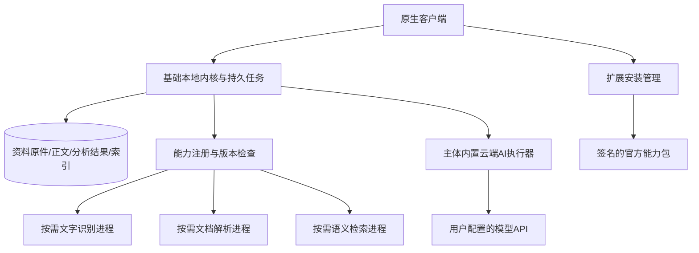

# 轻量基础客户端与可选扩展方案

日期：2026-10-23（Asia/Shanghai）。状态：已获授权，分阶段改造中。面向官网直接分发的 macOS 客户端，本轮不考虑 Mac App Store，也不改变既有功能的收费规则。

## 1. 产品目标与主要决策

用户第一次安装即可管理、采集、阅读和搜索资料；扫描识别、复杂文档解析和语义检索由用户在设置中安装对应扩展；云端 AI 分析代码保留在基础包。已有资料及已生成的结果始终属于用户，不依赖扩展是否安装。

主要决策：

1. 保留现有 SwiftUI/AppKit 界面和共享本地内核，先拆依赖，不重写数据库和业务逻辑。
2. 基础包自带精简 Python，用户无需安装 Python、Docker 或启动后台命令。取消重型扩展不能影响基础启动。
3. 扩展按“文字识别”等功能命名，第一阶段仅分发项目自己构建的官方能力包，不引入第三方插件市场。
4. 安装是用户明确操作，下载与功能调用分别授权。保留或配置 AI 功能不代表允许发送资料或调用模型。
5. 所有正式扩展都是锁定版本的预构建产物，用户设备上不运行 pip 安装，也不现场编译。
6. 基础包和扩展分别发布，版本不兼容时保留可用旧版；安装和升级不修改已签名 App 内部文件。

## 2. 当前实现核验与体积目标

基线为 `apps/macos/release.json` 所指 A 方案图标版，数据库 schema16、插件1.0.5。前次存储测量约996.2 MB为应用文件逻辑大小，不含单列的模型文件，也不是进程内存。

当前实际关系：

- 原生客户端通过 `MacKernelHost` 启动包内 Python 的本地 Host，Host 再管理 Worker；资料读取、数据库和加工依赖这个内核。
- `runtime/requirements.in` 把基础服务、文件解析、Paddle、FastEmbed 等根依赖合在同一锁文件中。
- `semantic.py`、`domain_node_index.py`、`summary_retrieval.py`、`domain_retrieval.py` 有模块级 NumPy 引用，不能只删除向量引擎目录。
- 扫描版 PDF 通过 PaddleOCR；归档图片已有 `MacImageTextRecognizer` 的 macOS Vision 实现。两者的引擎及适用范围不同。
- AI API 调用已有内嵌执行器，不需要把大语言模型权重打进基础客户端。

静态依赖闭包估算：以 FastAPI、Pydantic、SQLAlchemy、Uvicorn、HTTPX、Pillow、MCP、SSE-Starlette、PDFium 为基础根依赖，在当前运行包的已安装元数据中约31个包、42.71 MB。加现有 Python 约37.6 MB、原生主程序约13.2 MB及代码资源约15 MB，数量级约110 MB。

此估算尚未经过最小环境启动、动态导入、原生链接和商业签名验证，不能作为已实现体积或下载大小。第一阶段以**基础安装体积150 MB以内**为验证目标，最终同时报告压缩下载量、安装后逻辑大小和实际磁盘分配量。若不达标，按测量结果调整，不为达数字破坏现有功能。

## 3. 基础功能与扩展边界

| 模块 | 功能范围 | 默认状态 |
| --- | --- | --- |
| 基础客户端 | 知识库/项目/标签管理、笔记、TXT与Markdown、现有基础网页读取及插件采集、图片保存显示、数字版PDF阅读与文字提取、精确搜索及片段定位、阅读恢复、回收站、备份恢复、存储统计 | 随包可用 |
| 文档解析 | 当前已支持且经验收的Office等格式转换、复杂PDF版面解析；首批保留现有格式集合，不因扩展化擅自扩大格式承诺 | 按需安装 |
| 文字识别 | PaddleOCR及所需图像处理依赖、选定的OCR模型；处理扫描版PDF等无可提取文字的内容 | 按需安装 |
| 语义搜索 | FastEmbed、ONNX Runtime、NumPy/分词组件及固定向量模型；原文与摘要向量索引、语义查询和片段定位 | 按需安装 |
| 云端AI知识分析 | 用户配置API后的单篇分析、AI标签、新概览和知识库更新；执行代码、提示词与校验契约随主体发布，不含本地大模型权重 | 随包可用，调用仍需确认 |
| 本地大模型 | 未来的离线生成引擎及模型权重；目前没有已交付的本地生成模型，不在首版提供可安装入口 | 后续规划 |

边界约定：

- 基础图片显示、下载、文件有效性检查仍保留；Pillow如仍被基础归档依赖，留在基础包。OpenCV等大型处理依赖归扩展，不为了“图像处理”这一名称把普通文章图片也禁用。
- 基础包保留PDFium的轻量文字提取与既有PDF阅读器，不把数字版PDF强制当成付费或重型解析任务。
- 未安装OCR时，扫描页应显示“尚未识别，需要文字识别扩展”，原件仍能打开；混合PDF中已有文字可用，不能把空白页当作识别成功。
- 基础包保留系统图片OCR适配，是否继续自动识别沿用当前产品行为。设置说明“文字识别扩展”提供的是扫描文档等增强能力；扩展卸载不会移除macOS系统框架。
- 云端AI分析不依赖本地大语言模型，也不强制依赖语义扩展。摘要生成、关键词索引和向量索引分开记状态，不能因没有向量模型而让分析永远“处理中”。
- 知识库AI问答首版明确依赖已配置的云端AI及语义搜索能力；未满足时说明缺少什么，不静默冒充完整语义问答。
- 已有总结、AI标签、概览、问答记录和引用的只读展示放在基础包，卸载执行扩展后仍可查看。
- Agent/MCP本地接入与独立授权保留；只开放已可用能力，缺少扩展返回明确原因，不把语义请求悄悄替换为精确搜索。

## 4. 设置中的“扩展功能”

在设置增加独立“扩展功能”，以功能卡片呈现，不向普通用户展示Python库名。

每张卡片包含：功能名称、简短说明、适用文件/场景、版本、下载大小、安装占用、运行方式（本机或调用用户配置的API）、状态和操作。详细依赖、许可和版本信息在“详情”中查看。

例：

```text
文字识别
识别扫描版 PDF 中的文字，识别完成后可搜索。
在本机运行 · 版本 x.y.z
下载 xxx MB · 安装后 xxx MB
                                      [安装]
```

大小必须来自已发布包清单，包含本次缺失依赖；已安装共享环境不能重复计入下载大小。不得把待测估算写成商品页面实测值。

推荐状态与操作：

| 状态 | 用户看到的操作与行为 |
| --- | --- |
| 未安装 | 安装；展示实际大小及依赖 |
| 下载中 | 明确进度；可取消，支持按服务器能力断点续传 |
| 校验/安装中 | 分步状态；尚未激活，取消时清理本次暂存 |
| 已安装 | 版本、已占用大小、停用、卸载 |
| 有更新 | 用户主动更新，显示变化及大小 |
| 等待任务结束 | 说明尚有任务使用该版本，原版本继续服务 |
| 不兼容 | 原因及升级客户端入口，不尝试执行 |
| 失败 | 具体原因和重试；已安装可用版不被破坏 |

首次启动不弹扩展安装向导，不自动下载所有包。用户触发缺失功能时提供“前往安装”说明；安装完成只恢复本机、无需再次授权的解析任务。可能产生费用或向外发送内容的AI任务仍需原有确认，不因安装完成自动提交。

“模型与AI”继续负责API配置与调用授权；“扩展功能”负责安装。两处互相提供入口，避免出现两套模型配置。

## 5. 技术结构与进程边界



保留现有Host/Worker对业务队列的所有权，加受管扩展执行适配。基础Worker负责调度和结果落库，扩展执行器接收有界任务输入、返回有版本的结果，不自行修改核心数据库。重型依赖通过独立进程加载，避免扩展的动态库冲突或崩溃拖垮基础服务；无任务时不常驻大型模型。

第一版复用现有业务函数和结果契约，用小型适配器隔离执行。没有必要新建远程服务、容器编排或通用插件框架。

### 5.1 存储布局

```text
知识收集箱.app/
  Contents/Resources/runtime/        精简基础内核、Python、基础依赖

~/Library/Application Support/<bundle-id>/
  extensions/
    packages/<能力>/<版本>/<平台>/    已验证的只读版本目录
    staging/                        下载、校验与安装暂存
    active.json                     原子切换的激活记录
```

扩展是当前用户、当前机器共用的程序文件，不复制到每个知识库。知识库内容与生成结果继续存放在各自资料目录。API凭证沿用既有归属与私密通道，不放进扩展清单。

共享Python及必要公共依赖尽量只保留一份，扩展拥有独立依赖目录；第一版仅支持已验收的Python ABI和架构组合。不兼容库不能靠覆盖基础site-packages解决，确需不同运行时的扩展另行打包并明确占用，不能为“零重复”牺牲隔离。

### 5.2 能力与包契约

内核至少区分 `not_installed`、`installing`、`ready`、`disabled`、`incompatible`、`failed`。客户端和本地接口读取同一能力状态，不能只把按钮隐藏而后台仍发任务。

包清单包含：能力ID、包版本、客户端/内核契约兼容范围、CPU架构、最低系统、Python ABI（如使用）、依赖版本、下载及解压大小、文件摘要、入口和许可证。包清单自身必须经可信发布签名验证；同一下载站提供一个未签名SHA值不足以证明来源。

下载后按顺序执行：空间/兼容预检 → 独立暂存 → 受限解压 → 签名及完整性检查 → 无用户资料的健康检查 → 任务安全点 → 原子激活。文件路径越界、异常链接、超量解压、签名错误一律拒绝。

官网分发仍应遵循Apple的Developer ID签名、公证和Hardened Runtime交付要求。基础App与包含可执行代码的扩展分别验证，不能通过移除隔离标记或破坏App签名解决加载问题。具体辅助进程、公证封装及动态库加载策略必须在干净Mac上验证。

参考：[Apple Mac软件分发](https://developer.apple.com/documentation/xcode/packaging-mac-software-for-distribution)、[Apple公证说明](https://developer.apple.com/documentation/security/notarizing-macos-software-before-distribution)。

## 6. 任务、卸载与版本兼容

- 缺失扩展的任务进入“等待安装”，保留原件和任务输入，不以导入异常标记为资料损坏。
- 已开始任务绑定扩展版本与模型版本。升级、停用和卸载先停止接收新任务，现有任务按检查点排空；不能杀掉可能已发往厂商的调用并自动重发。
- 结果未知的模型调用继续沿用现有未知状态保护。安装、重启、升级都不能抹掉此状态。
- 扩展结果仍校验原文版本及输入指纹，文章修改后的迟到结果不能覆盖当前版本。
- 卸载仅移除扩展程序及其专属模型，不删除原件、识别正文、总结、标签和用户问答。共享依赖仍被其他扩展使用时保留。
- 已有向量索引可保留，UI显示语义能力未安装。安装相同模型可验证后复用；模型、维度或切片契约变更时重建派生索引，不混用不同模型向量。
- 首版不提供“卸载时顺便清理资料”。临时下载失败和旧程序版本的回收可以由安装管理处理，用户数据清理单独设计。

## 7. 老用户迁移与备份

新用户默认安装基础包，主动选择扩展。老用户不应在一次普通更新后突然失去全部已有能力。

建议提供轻量基础安装包及完整离线安装包，两者最终共用同一基础App、能力包版本和数据库格式；完整包只是预置官方扩展的交付集合，不维护另一套客户端代码。

老用户首次切换轻量版时，明确列出当前使用的能力及所需扩展，用户选择后再迁移。能复用的旧模型需按新官方清单重新核验；旧整包runtime不能未经验证直接冒充新版扩展。

迁移前检查临时峰值空间和在途任务，保留上一正式App和现有备份恢复路径，不删除原runtime来腾空间。扩展安装失败时基础阅读可用，旧资料完整。

知识库备份保留原件、解析正文、分析结果、已有兼容索引和现有配置规则，不打包扩展二进制及可重新下载的模型；增加最小能力/模型版本描述用于恢复提示。恢复时不自动下载代码、不自动提交解析或AI调用，用户决定是否安装和重建。

持久化兼容影响在实施前单独确定：扩展安装记录使用独立、有版本的文件；任务新增等待能力状态时要同步更新API、Swift解码和恢复规则。现有schema16是起点，不能预先宣称整个改造无需迁移；一旦新状态或字段需要迁移，必须有兼容测试和受支持的回退路径。

## 8. 分阶段实施与验收

| 阶段 | 工作 | 完成标准 |
| --- | --- | --- |
| 0：最小包验证 | 拆基础/扩展依赖锁，扫描动态导入与原生链接，离线构建精简候选；先不改正式交付 | 无OCR/文档增强/向量包时可完整启动，提供真实体积和功能差异 |
| 1：能力边界 | 引入统一能力状态、缺失处理与惰性加载，隔离重型执行，拆开摘要/关键词/向量状态 | 基础采集阅读、精确搜索、备份、MCP在无扩展时通过；待安装任务不阻塞其他队列 |
| 2：安装闭环 | 设置扩展页面、签名包清单、下载校验、原子安装、重试及安全升级卸载 | 先以语义搜索一个能力跑通端到端；网络中断、坏包、空间不足、并发安装均可恢复 |
| 3：完整拆分 | 接入OCR、文档解析包及版本绑定，保留主体AI；沿用既有业务验收样本 | 扩展单装、组合安装、停用、升级、卸载及任务中断恢复矩阵通过 |
| 4：迁移和交付 | 轻量/完整离线安装、旧数据升级、备份恢复、官网制品分发 | 干净设备签名公证及无开发环境运行通过；老用户资料和既有结果保持 |

每阶段仅发布通过验收的范围，不把轻量包“能够打开窗口”当作业务可用。

关键验收场景：

1. 全部扩展未安装且断网，依然能打开已有库、查看图片/正文/PDF、精确搜索、删除恢复和备份。
2. Markdown导入、普通网页采集、阅读位置恢复、原文命中定位与现版本一致。
3. 扫描PDF、复杂文件和语义搜索准确显示缺失能力，不显示空成功、不静默降级。
4. AI分析没有语义包也可完成，已有AI结果卸载后仍可读；知识库问答展示明确依赖。
5. 下载失败、校验失败、解压失败、崩溃重开只影响本次安装；旧可用版本继续工作。
6. 升级中任务版本固定，无重复模型调用；待安装任务恢复不越过AI确认。
7. 多知识库共用扩展程序，业务结果及权限保持隔离；备份恢复不携带密钥和可执行包。
8. 记录冷启动、空闲内存、执行峰值与磁盘体积。拆包主要减少首次下载和安装体积，不能承诺安装所有能力后的总空间或推理峰值同幅下降。

## 9. 商业化边界

能力包机制可支持免费/付费授权，但安装状态、购买状态和API调用计费是三个独立维度，本轮不设定收费档位、不增加登录要求。首版优先做到用户看得懂、按需安装、失败可恢复、资料不受影响。

现有API Key的用量仍由用户配置的服务商决定，不能把购买本地扩展描述为包含云端调用额度。本地离线包的第三方依赖和模型许可证必须按实际发行清单核对后交付。

2026-10-23 用户确认：云端 AI 分析代码保留在主体包，并授权开始改造。暂无在线下载服务器，先交付基础包、官方扩展离线安装及下载机制；无下载地址时明确说明，不伪造可下载状态。实际实施、测试及交付进展另记验收文档，未发布的候选不能描述为已更新正式 App。


## 10. 首版实际实现边界（2026-10-23）

以上第4—8节包含长期设计目标；首版以本节和验收记录为准，不代表这些目标已全部实现。

- 基础 App 已拆出三种能力，云端 AI 执行器、提示词、结果校验及关键词索引仍内置。保留 Python 与 PDFium 等必要依赖，用户无需配置开发环境。
- 当前三包为 macOS arm64／Python3.10、版本1.0.0。App 内置目录固定包名、完整 SHA-256、文件清单摘要与解压大小，只接受当前 App 配套官方包；尚不支持独立更新远程目录或第三方包。
- 设置提供离线导入、配置 HTTPS 源、下载安装进度、取消、启用、停用及卸载。没有下载源时禁用下载安装，仍可离线导入。尚未连接生产 CDN；下载逻辑用模拟 HTTPS 响应验证，不宣称实际网站下载已验收。
- 下载失败可重新下载，首版不支持断点续传。完整下载后验证大小与摘要，再受限解压、逐文件验证并原子发布；取消或失败不激活半成品。
- 首版复用现有 Host／Worker 执行方式，进程启动时固定扩展选择并持有共享文件锁；安装、启停、卸载需正常退出并重开 App。尚未新增每种引擎的独立进程和空闲释放，拆包主要降低基础安装体积，不承诺推理峰值内存同步下降。
- 使用中的包先标记待卸载，无进程占用后删除代码与专属模型。已生成正文、AI分析、标签、概览与历史结果保留。某些辅助依赖分别包含在能力包中，全部安装的总空间可能略大于旧完整包。
- 缺扩展任务在数据库仍保留兼容的 pending 状态和明确错误标记，API显示 waiting_extension；扩展可用后恢复本地解析，不重复发送 AI 请求。等待期间用户手动编辑正文会取消自动恢复，显式重试后仍保留旧版本。
- 数据库仍为 schema16、插件1.0.5，不迁移用户文章或清空索引。扩展配置为独立 version1 私有 JSON；旧完整包不认识新目录但可继续使用原有内置引擎，回退不删除已生成结果。API 新增可选能力查询和精确模式参数，默认调用形状保持兼容。
- 新基础包默认不安装三类扩展；原有资料及已生成结果保留，重新执行相应能力需由用户手动安装配套包。不会自动下载或替用户安装所有能力。
- 当前沿用项目本机 ad-hoc 签名。Developer ID签名、公证、干净设备矩阵、商业分发许可证核对和生产下载站属于商业发布前后续工作，不以本机验收代替。


## 11. 国内公共源依赖安装调整（2026-10-24）

用户明确要求优先使用开源依赖的国内公共下载源，不自行租用安装包服务器。66个可选Python依赖已从清华镜像实际下载并核对原锁文件／PyPI SHA-256；阿里云同版本文件列表均已核验，代表性文件另做完整下载。魔搭Qdrant同模型仓库的7个文件与既有模型逐字节一致，Paddle两个官方BOS模型也完整下载校验通过。

语义搜索和文档解析改为直接下载固定wheel及模型文件，再重现原扩展目录与元数据；输出逐文件符合原manifest，自检成功后原子激活。无需pip、源码编译、系统Python或开发工具，不设第三方插件或自动追踪最新版。旧扩展身份、离线包和已安装结果继续兼容。

OCR Mac wheel仍引用Homebrew GCC等原生路径，普通用户直接安装尚未解决。用户选择“OCR暂时保留离线安装，先上线另外两项直接下载”，因此不启用该项依赖下载、不自动安装Homebrew、不引入自托管费用。

普通设置隐藏下载服务器配置，在线可用项只提供“安装”、进度和取消；OCR说明仅离线可用。旧下载源CLI保留兼容，不再面向用户展示。重启规则仍保持：下载期间可继续使用，安装和启停需正常退出重开生效，避免直接热替换Host／Worker内的原生库及静态配置。未实现逐引擎隔离或自动后台重启。

本节替代第10节“所有在线来源均未配置”的旧状态；实际发布结果以本次验收记录为准。没有承诺公共镜像的商业SLA，网络不可用时保留重试和离线备用方式。


## 12. OCR 逐项依赖下载（2026-10-27）

用户进一步要求文字识别也按依赖列表下载，普通用户无需获取整份离线扩展包。本轮找到固定 GCC arm64 运行组件的清华／中科大公开镜像；完整清华文件与官方元数据及原制品 SHA-256 一致。OCR 共 53 个 Python wheel、1 份原生组件归档、2 份官方模型归档，在线约408.3 MB，只提取所需运行文件，安装后781.2 MB。

安装器内置受信的固定兼容规则，校验源长度与摘要、重现原生加载路径及已验收文件字节，再校验原目标清单。不在用户设备执行编译器、链接工具或 Homebrew，也不要求系统 Python／Xcode。新安装输出与既有离线包逐文件一致，旧扩展身份保持；离线导入继续备用，无数据库迁移。

设置增加可展开的逐项下载清单，展示名称、版本、大小和状态，安装开始自动展开；用户仍只点击一次安装。取消、失败不激活半成品；重启生效规则及云端 AI 主体内置规则保持。此节取代第11节 OCR 暂限离线的状态。公共镜像无商业可用性保证，保留备用源及离线方式；Developer ID、公证和干净设备发行验收仍属于商业交付边界。实际结果见本轮验收记录。
