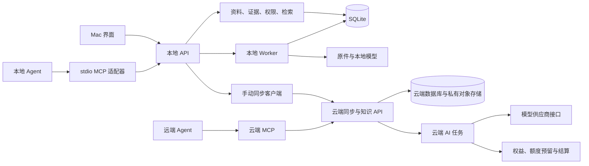

# 实施设计：本地服务、手动同步与 AI v0.2

日期：2026-09-30。状态：依据[已确认架构决策](./架构决策-本地优先与云端增值服务.md)细化的工程设计草案，已纳入复核修订，尚未实现；阶段契约冻结和验收完成前不标记为设计或产品全部完成。本文中的接口、对象和状态是拟新增契约；具体 SDK、价格、容量和保留天数须经验证后确定。

执行顺序见[实施路线与验收](./实施路线-本地优先-v0.2.md)。本设计处理已确认的本地独立运行、免费数据控制、付费手动同步、云端 AI 额度和两种 MCP 连接。

## 1. 运行结构与模块边界

- 本地 API、Worker 保留 Python 实现，Mac 负责管理进程；首先复用当前服务层与客户端调用契约。
- 本地服务负责资料、证据和权限。stdio 适配器只转发已授权调用，不获取数据库连接信息、不执行迁移。
- 云端以模块化业务服务起步，划分账户与权益、同步、知识读取、AI、计费模块；独立 Worker 执行耗时任务。
- 各端共享资料和证据契约，但存储、会话及连接凭证独立。云端私有存储中的访问路径由服务端授权，不能由客户端自报归属决定。
- 本地文件写入与数据库事务通过临时文件、最终落盘和可恢复任务协调。文件系统操作不被假定为数据库事务的一部分。

## 2. Mac 独立服务

### 2.1 安装与目录

应用包包含 Swift 可执行文件、可搬迁 Python 运行环境、后端代码、锁定依赖和必要模型。开发 `.venv` 不作为发行运行环境。是否全部模型随包提供在打包验证中按功能核对，不将运行时下载伪装为离线可用。

按现有 bundle identifier 定位用户目录；显示名称变化不改变数据目录：

| 路径类别 | 内容 |
| --- | --- |
| `Application Support/<bundle-id>/` | SQLite、原件、图片、待处理输入、持久任务、备份清单 |
| `Caches/<bundle-id>/` | 可重新下载的模型、可重建索引辅助数据和阅读缓存 |
| `Logs/<bundle-id>/` | 脱敏运行日志，按配置轮转 |
| 系统钥匙串 | 本地服务凭证、云端会话凭证及用户选择保存的连接密钥 |

数据库、原件和用户 AI 产物不得放入 `.app` 或可随意清理的缓存目录。每个持久资产采用不可变标识和内容摘要；原件下载或写入完成后校验摘要再替换临时文件。

### 2.2 启动、就绪与退出

状态：`stopped → preparing → migrating → starting → ready`；失败进入 `failed`，受限次数恢复后要求用户处理。Worker 不可用时可进入 `degraded`：允许已就绪 API 的采集与关键词查询，明确解析和索引暂停。

启动流程：获取当前数据根目录的进程锁 → 检查运行环境 → 检查数据库版本并备份 → 执行迁移 → 启动 API → 校验就绪 → 启动 Worker → 恢复本地任务。

- API 仅绑定 loopback，由系统分配端口或处理配置端口冲突。服务发现记录保存实际地址、实例 ID、PID 和 API 版本，不保存凭证；调用者须验证实例，不能仅凭 PID 判断服务身份。
- 独立的就绪检查验证数据库可读、迁移完成和本地身份可用；基础存活检查不等于业务就绪。向量模型未就绪不阻断基础采集和关键词检索。
- 关闭主窗口保留菜单栏及服务；明确退出时停止接受新任务，通知 Worker 退出，再按超时回收自己启动的子进程。不结束用户独立启动的进程。
- 首版不注册系统级常驻服务、不默认开机启动。Mac 休眠和应用退出导致本地 MCP 不可用，应返回明确状态。
- 日志不包含正文、完整查询、令牌和第三方登录信息；诊断包由用户主动导出。

### 2.3 本地身份与迁移兼容

新安装自动创建设备本地身份，无需邮箱、SMTP 或云端登录；本地凭证由受控启动过程产生，不开放一个无认证的通用登录入口。现有开发登录继续限定于开发环境，不能成为发行版自动登录方案。

引入稳定 `library_id` 与 `device_id`。本地身份和云端账户通过显式绑定关系连接；上传时服务端验证库归属，不信任客户端提供的云端 `owner_id`。退出本设备立即清除本端云会话并停止本端通信，保留本地知识使用。云端定时任务归账户管理，设备退出不自动停用；停用是独立操作，只有服务端确认后才能显示成功。离线停用请求明确显示待提交，不能保证已停止云端消费。账户切换不能把旧账户绑定的待同步修改发送给新账户。

首次导入既有开发库必须先停止对应 API/Worker，使用一致性数据库快照和资产清单验证，在新目录迁移副本；不移动、改写原开发数据库。存在多个账户时列出待导入范围，不能凭邮箱猜测归属。

## 3. 数据契约与索引

| 对象 | 关键字段与规则 |
| --- | --- |
| `Library` | `id`、本地身份关联、可选云端绑定；全局 ID 在同步后稳定 |
| `Domain`、`Project` 及关联 | 稳定 ID、库归属、实体版本、删除状态；项目目标、约束、背景及资料关联均同步，连接授权凭证独立管理 |
| `ReplicaState` | `library_id`、`device_id`、同步 epoch、已应用云端序号、协议版本 |
| `Source` 及上下文 | 本地修改代次、已知云端实体版本、待同步状态；显示版本与同步版本分开 |
| `SourceRevision` | 不可变 `id`、父版本 ID、内容摘要、解析版本；现有整数版本号仅作端内展示，不能作为跨端唯一身份 |
| `EvidenceChunk` | 保留证据 ID、版本关联和定位；同步不重新切片或重新生成证据 ID |
| `Asset` | `id`、库归属、摘要、大小、媒体类型、原件可用状态；不可公开跨账户按摘要下载 |
| `AIArtifact` | `id`、任务 ID、结构化内容、输入版本清单、引用、模型及提示模板版本、生成时间、过时标记 |
| `LocalChange` | 操作 ID、实体 ID、基础云端版本、固定提交载荷、设备 ID、本地代次、状态 |
| `CloudChange` | 库内单调递增序号、操作 ID、实体版本、变更类型和载荷引用 |
| `Conflict` | 本地修改、云端当前内容、基础版本、冲突类型、解决状态 |
| `DeletionMarker` | 被删除对象 ID、库内删除序号、删除状态；保存最小信息以拒绝复活 |

写入业务数据和本地变更记录处于同一数据库事务。对同一实体的多次离线编辑可在发起同步前合并为一次固定提交；已经发出的操作不可变。其后编辑记录为新的待同步修改，基础版本在前一提交确认后重新确定；确认旧操作不能清除这些新修改。

同步覆盖知识域、项目及关联、资料可见性、原件、提取正文、证据、个人上下文、实践记录、用户管理的标签及 AI 产物。规则标签可重算，需记录规则版本。连接密钥、设备会话、诊断日志、模型缓存、关键词和向量索引不作为知识数据同步。

初期采用实体版本检查和冲突副本，不做自动正文合并。SQLite 继续作为本地存储；云端保留关系数据库和私有对象存储方案。索引模型与切片规则带版本，模型升级先建立新索引，确认可用后切换，允许关键词降级。

### 3.1 版本迁移与关联完整性

L1 冻结迁移契约，S0 实施同步字段及约束调整：保留既有 revision UUID、证据 UUID 和本机已有整数展示编号；接收新 revision 时按端分配未使用的展示编号，不把其他设备的编号直接写入本端唯一列。云端以 revision UUID 标识版本；传输中的旧编号仅作来源元数据。同一 UUID 对应不同内容摘要必须拒绝。

旧整数版本入口继续解析本机既有映射，跨端引用、同步及新增客户端契约必须使用 UUID。S0 验收两端各自产生第 3 版、冲突副本保留和后续接收时无唯一约束失败，旧引用仍定位原证据。

知识域、项目先于引用它们的资料提交和应用，或放入同一原子提交组；缺失依赖返回可恢复错误，不自动创建同名对象。离线创建的同名知识域保留各自 ID 并提示用户解决，现有按账户和名称唯一的约束在 S0 调整为适合库身份的约束，名称不充当同步身份。

项目编辑及资料移动携带基础版本；项目删除与关联解除原子执行，保留资料。非空知识域删除要求明确迁移或删除所属资料，首版拒绝隐式级联删除。项目删除与迟到关联、知识域删除与迟到资料均进入冲突；移动资料及权限变化在同一提交中生效。

## 4. 手动同步协议

以下接口为拟新增云端契约，路径与字段在实现阶段冻结。设备身份、库权限、会员和协议兼容性均由服务端检查。

| 接口 | 作用 |
| --- | --- |
| `POST /v1/libraries/{id}/sync-sessions` | 幂等创建一次手动同步会话，返回会话 ID、epoch 与服务端能力 |
| `POST /v1/libraries/{id}/assets/uploads` | 创建受控原件上传任务，检查容量和范围 |
| `POST /v1/libraries/{id}/assets/{asset_id}/complete` | 校验大小与摘要，标记原件可引用；重复确认幂等 |
| `POST /v1/libraries/{id}/sync-sessions/{session_id}/commit` | 提交固定变更，返回逐项接受、冲突或拒绝结果 |
| `GET /v1/libraries/{id}/changes?after=…&until=…` | 分页获取固定序号范围的变更，包含删除和 AI 产物 |
| `POST /v1/libraries/{id}/devices/{device_id}/ack` | 确认客户端已持久应用的序号；下载未应用不能提前确认 |

一次手动同步的执行顺序：

1. 本地事务固定本次变更边界并保存会话；显示提醒和待上传、待下载状态。
2. 上传这批变更所需的资产，在服务器完成校验。断点恢复及续传策略由资产实现决定；失败不得宣称原件已上传。
3. 提交资料变更。在短数据库事务中检查实体基础版本、资产归属和可用性，写入内容、版本与变更序号。序号的分配与提交处于同一事务，并按库串行化提交；不能只依靠不同请求的到达时间排序。
4. 库、操作 ID 建立唯一约束。相同 ID、相同载荷重试返回原结果；相同 ID、不同载荷拒绝。每个资料及其版本、证据、上下文构成一致提交组；跨资料批次可以部分成功，返回逐组结果。
5. 完成提交后固定本轮拉取上界，分页下载并持久应用；之后新产生的云端变更留待下一次手动同步。
6. 依据操作 ID、本地代次和实体云端版本识别自己的提交回传：确认已提交 A，保留随后编辑 B，并将 B 的基础版本推进到已确认 A；重复回传不重复创建变更。收到其他操作时，先忽略已应用版本；无本地修改可直接应用，有未提交修改则保存云端基线和本地内容并创建冲突。其他设备在 A 后提交 C 时，不能把 B 无条件改为基于 C，以免跳过冲突。
7. 已应用变更和游标在同一事务提交，资产接收使用临时文件与恢复状态。只有必要原件验证完成、变更已应用且无未处理冲突时显示本轮完成。

冲突操作提供查看双方、采用云端、保留本地并重新提交、保留为新资料。重新提交依据当前云端版本，依然可能再次冲突；不提供绕过版本检查的强制覆盖。采用云端也保留用户本地修改的恢复副本。

未上传的孤立暂存资产按独立配置清理，已引用资产不得误删。按账户计算容量，重复上传确认不得重复增加占用。

### 4.1 删除、过期游标与恢复

- 云端删除后，旧设备上传的编辑返回已删除冲突，保留本地恢复副本但不恢复云端资料。
- 首版云端对曾接受的实体 ID 保留最小删除标记；详细变更历史可在快照完成后压缩。未来删除标记清理必须配合同步 epoch 和全量重新接入规则。
- 游标落后于可读取历史时返回 `resync_required`，下载全量快照。应用前保存本地待同步修改与原件，然后按当前状态重新检查；旧 epoch 操作不得直接重放。
- 云端到期后的只读下载不上传新编辑。主动删除走独立的受控接口，不能借此接口修改其他内容。
- 全量快照只包含当前授权、未删除的数据；退出账户、撤销设备、取消云端库绑定分别处理。

## 5. 导出、备份、恢复与回收站

免费提供两种形式：可读导出（元数据、正文、备注、AI 产物、原件和缺失清单）与应用恢复包（数据库一致快照、资产清单、摘要及格式版本）。不导出连接 Token、云端会话、支付凭证、模型缓存或本地待付费请求。

恢复包中的数据库从一致快照副本生成，清除会话、授权密钥及不应重放的任务记录后再封装；不能直接把含凭证的运行数据库放入压缩包。清理过程不修改正在使用的数据库。

备份使用 SQLite 一致性备份能力，暂停资产发布和清理并固定原件清单；数据库快照不能单独代表完整知识库。[SQLite Backup API](https://www.sqlite.org/backup.html)

恢复先验证格式、大小、路径安全与摘要，再恢复到隔离目录、迁移和完整性检查；用户确认后切换库，保留原库。损坏恢复包不得覆盖现有数据。新恢复副本使用新设备身份，原同步绑定重新验证，禁止复用旧设备游标或令牌直接上传；可读导入采用新库身份。

回收站是用户可以恢复的删除状态；对检索、MCP、AI 立即隐藏。永久删除清除原件及派生内容并保留最小同步标记，云端备份副本在已公开的清理周期内清除。回收站与备份天数配置化，发布前确定，不在本文虚构默认承诺。恢复回收站内容使用新的受控恢复操作，旧离线编辑不是恢复指令。

### 5.1 云端灾难恢复

云端发布前建立数据库备份及日志恢复、私有资产版本和清单、删除记录、任务与账本的一致恢复流程。RPO（最多可丢失的数据时间）和 RTO（恢复服务所需时间）以实测和业务要求确定，发布前冻结，不能用永久保留代替备份保证。

恢复先暂停写入、调度和付费调用，在隔离环境选定恢复点，核对数据库引用的资产摘要与可用性。独立保存恢复窗口内的删除记录和外部调用/支付记录；补齐恢复点之后已确认的删除与结算后才重新开放服务。无法确认删除或权限状态的数据隔离，不能直接恢复可读。

如果云端已确认历史发生回退，提升同步 epoch，拒绝旧会话继续提交；客户端保存未同步内容及已确认但云端缺失的内容，按新快照重新核验，不静默丢弃，也不自动重放。操作幂等记录应覆盖重试窗口；超出保留范围的旧操作要求重新核验。

恢复后的 AI 任务先按供应商请求 ID 对账，禁止因状态回退自动再调用模型；支付按渠道交易 ID 对账，充值与结算不可重复执行。D0 验收数据库与文件不一致、删除后恢复旧备份、客户端游标超前；有 AI 或支付时追加在途调用、充值和结算恢复演练。

## 6. AI 任务与额度

### 6.1 任务输入与产物

拟新增 `POST /v1/ai/tasks`、`GET /v1/ai/tasks/{id}`、`POST /v1/ai/tasks/{id}/cancel`，由账户权限和任务归属控制。请求包含任务类型、库 ID、固定输入版本清单、最大额度、价格版本和幂等键；服务端检查每条证据归属及当前删除状态。

手动任务接受用户明确的费用上限。定时任务具有开关、范围、执行频率、周期预算与模型规则；保存配置不自动上传本地资料。定时任务扫描云端固定快照，仅分析需要更新的版本。调度执行记录与分析输入摘要共同去重；明确的再次生成创建新任务并重新说明费用。

RAG 沿用现有关键词及向量检索能力：先按库、权限和删除状态筛选，再组合检索、去重并按输入预算选取证据，固定实际选中的版本后调用模型。输出引用必须能定位到这些证据；证据不足时返回不足结论，不补造出处。生成结果写入独立产物，在读取时再次检查资料权限和删除状态。检索、可选重排与生成分开记录用量，付费步骤受同一任务总预算约束；首版不引入无限循环的自主 Agent。

状态：`queued → running → succeeded / failed / cancelled / outcome_unknown`。取消是请求，不能保证供应商已经停止计算。供应商执行结果不明时进入对账流程，不立即再次调用模型，也不把数据库任务幂等误当作供应商调用幂等。

`AIArtifact` 是用户数据，按已确认保存规则保留；临时上传、任务执行中间数据和诊断信息使用各自保留策略。产物的过时性按输入版本比较，不能只依赖本机时间；多资料报告列出每条输入版本，资料删除后使相关产物不可通过 Agent 继续读取，人工重新生成另建任务。

到期或权限变化时重新校验：禁止新任务持久新增到已只读的云端库；已受理任务如产生有效结果，保存在独立可领取任务结果区，允许用户手动下载，不借此恢复知识库写权限。是否完成在途调用及如何结算遵循明确的产品计费规则；不得丢弃已收费结果。

### 6.2 账本与支付

拟新增额度账户、额度授予批次、预留、追加式账本、结算和供应商调用记录。额度使用整数最小单位，不用浮点余额；购买与赠送分批记录，保留来源和适用规则。

| 时点 | 必须满足的规则 |
| --- | --- |
| 充值入账 | 服务端验证支付通知和订单金额、账户、币种，重复通知仅入账一次 |
| 接受任务 | 事务内校验可用额度并预留上限，与任务创建一致；并发不能重复使用余额 |
| 调用模型 | 限制输入、输出和步骤预算，记录每次调用；供应商凭证仅在云端 |
| 成功结算 | 使用受理时价格版本和服务器记录的实际用量，按任务唯一键结算并释放剩余预留 |
| 调用前失败 | 释放预留，不产生模型消费 |
| 调用后失败或取消 | 根据供应商实际用量和公开规则结算；平台承担重试成本还是用户承担须在上线前确定 |
| 结果不明 | 保留有限期待核实状态并对账，超时处理规则上线前确定，不能永久冻结额度 |
| 结果领取 | 校验归属、返回已有结果，不再次扣费 |

自动分析受周期预算和单任务预算双重限制。超预算不能静默增购或无限追加预留。模型故障重试和价格换算在服务端执行，不信任客户端上报 Token 数、余额和支付成功页面。

## 7. 权益与两种 MCP

权益按能力配置：`local_use`、`cloud_read`、`cloud_write`、`cloud_sync_write`、`remote_mcp`、`scheduled_analysis`、`ai_execute`；额度余额与会员是不同条件。首次公开套餐需明确免费账户购买额度资格及 AI 能力与会员关系。

账户与权益基础、会员订阅支付、AI 额度充值与结算分模块交付。会员同步及远端 MCP 不依赖 AI 额度功能完成；AI 消费必须通过额度预留和结算门槛。

已确认规则：本地能力不依赖会员；会员有效时支持多端同步和远端 MCP；到期后保留云端下载、导出和删除能力，停止知识库新增与编辑。权益应在服务端每次调用及关键提交时检查。

本地 MCP 通过轻量适配器调用本地 API；云端 MCP 使用经目标客户端验证的标准 HTTP 传输和授权。复用业务权限规则，分别保存连接凭证；Token、设备会话及本地连接不通过知识同步传播。只读检索不自动触发付费生成。

在返回中拟增加兼容性元数据：`data_origin`、`library_id`、`revision_id`、`cloud_sequence`、`last_sync_at` 和已知同步状态。云端只能描述已收到的数据，不能声称知道离线设备是否还有修改。现有字段保留兼容，SDK 与真实客户端测试后冻结输出结构。

连接撤销在所在服务立即阻止新读取。云端设备撤销阻止后续同步，无法收回已经交付的本地数据；离线设备也无法即时获知云端撤销。源资料仅 App 可见的状态同步后，云端读取按新状态执行，尚未同步的本地修改不能宣称已经影响云端。

### 7.1 浏览器与移动端接入

浏览器采集先写本机队列，再交付已配对的本地 API；本地重试不等于云端同步。E0 验证动态端口发现方案：由原生消息桥提供当前实例地址及受限配对信息，完成真实 Chrome/Edge 验证后冻结实现；网页不能调用配对入口或获得凭证。重启发现新实例并验证身份，账户和库切换不自动迁移旧队列。向云端上传仅由明确的手动同步发起。

移动端增加持久数据库、原件目录和系统分享落盘；免费本地采集无需云登录。会员登录后绑定库，显式点击同步，采用同一版本和冲突协议；离线和后台中断恢复不自动发起新一轮云端同步。移动端不以运行 Mac Python 后端作为前提，解析能力和本地检索支持范围按设备实测，缺失能力明确展示。

## 8. 验收场景与外部前置条件

验收必须包含：无开发 Python/Docker 的 Mac 启动、运行环境移动后加载依赖、服务崩溃与重复启动、离线采集重启恢复、恢复包损坏拒绝、旧数据迁移引用稳定、两设备旧版提交冲突、同步中编辑与断网、删除与旧设备重连、会员到期只读、AI 输入更新/删除、并发预留与未知结果对账、实际 MCP 客户端及云端越权读取。

外部前置条件只在对应阶段阻断发布：真实跨设备测试环境、发行签名与公证、云端账户和预算、模型账号与供应商用量验证、支付渠道及回调环境、套餐/容量/保留规则。未通过时如实标注未验证，不模拟已完成。

Mac 打包先验证原生库与运行环境的可搬迁性，再冻结发行方式；正式发行需处理内置可执行文件及库的签名。[Python macOS 文档](https://docs.python.org/3/using/mac.html)、[Apple 发行签名文档](https://developer.apple.com/documentation/xcode/creating-distribution-signed-code-for-the-mac/)。
