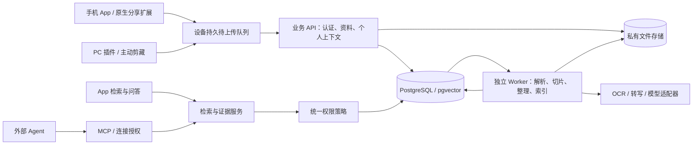

# 个人知识与 Agent 助手：MVP 技术方案

日期：2026-09-20。依据：[PRD v0.1](../prd/PRD-v0.1.md)。状态：待评审；用户已明确本次只完成方案与实施计划，确认后编码。不代表已实现或实测通过。配套文档：[MVP 实施计划](./MVP实施计划-v0.1.md)。

2026-09-30 架构决策：后续采用本地优先、会员手动多端同步与云端 AI 增值服务。本文涉及数据存储、同步和会员服务的早期假设，以[已确认架构决策](./架构决策-本地优先与云端增值服务.md)为准。

## 1. 交付目标和边界

验证一个核心业务闭环：用户从手机或浏览器保存资料并补充个人上下文，Agent 在授权范围内检索、查看证据、引用，用户记录实践结果。

完整 MVP 对应 PRD 的 P0，不把响应式网页当作原生分享，不把 REST 接口当作 MCP，不把关键词检索当作语义检索，不把链接保存当作全文解析。

建议分为三个可验收增量，使用同一套数据模型与后端，逐步累计交付：

| 增量 | 交付内容 | 验收边界 |
| --- | --- | --- |
| M1 基础闭环 | 账户、知识域、项目、文本/链接保存、插件正文/片段采集、个人备注与验证、版本化证据、关键词检索、只读 MCP、授权/撤销/删除、移动 App 基础界面 | 可用的工程验证版本；尚不代表完整 P0 |
| M2 输入与智能处理 | iOS/Android 系统分享、持久上传队列、图片 OCR、文本/扫描 PDF、音频/录音、公开网页解析、知识卡、混合检索和引用问答 | 功能覆盖 P0，供应商和站点支持清单经过样本验证 |
| M3 内测验收 | 双端真机、插件离线/切换账户、真实 Agent 客户端、权限矩阵、检索评测、导出与删除清理、成本与故障恢复 | 达到 PRD 试点门槛后交付内测 |

M1 不支持的输入必须明确拒绝或保留为待补充，不能显示虚假的处理成功。所有 P0 延后项仍保留在 M2/M3，不自行删除需求。

## 2. 技术选型

| 层 | 建议 | 理由与限制 |
| --- | --- | --- |
| 移动端 | React Native + TypeScript；iOS Share Extension 用 Swift，Android 接收分享用 Kotlin | 复用业务界面和 API 类型，关键分享生命周期原生处理；需真机和签名环境 |
| PC 插件 | Manifest V3 + TypeScript + React，Chrome/Edge | 用户触发 `activeTab` 和 `scripting`，避免申请所有网站常驻读取权限 |
| 后端 | Python + FastAPI + Pydantic + SQLAlchemy + Alembic | 文档处理与模型生态集成直接；模块化单体，无微服务拆分 |
| 主数据库 | PostgreSQL + pgvector | 事务、权限、版本和检索同库；先做小规模精确向量搜索 |
| 原文件 | S3 兼容私有对象存储；开发环境本地适配器 | 原件和派生产物分开，路径包含账户隔离前缀，禁止公开桶 |
| 任务 | PostgreSQL 持久任务表 + 独立 Python Worker | 首版复用数据库，不额外引入 Redis/Celery；通过租约与唯一键恢复任务 |
| 检索 | 中文分词关键词召回 + 向量召回 + RRF 合并 | 不假定 PostgreSQL 默认分词满足中文；重排序先作为可替换组件 |
| OCR/转写/模型 | 明确的 Provider 接口，按样本质量、部署区域和预算选定 | 不将某家服务写死；未配置时显示能力不可用，禁止返回模拟结果 |
| Agent | 官方 MCP SDK + Streamable HTTP + 服务端授权 | 锁定经选定客户端测试的协议/SDK 版本，不手写部分 JSON-RPC 冒充完整协议 |
| 本地开发/部署 | 单仓库、Docker Compose；API 与 Worker 分进程 | 初期不引入 Kubernetes、独立向量库或知识图谱 |

建议 Python 3.12、Node.js 22 LTS 作为待验证基线，实施时核对依赖兼容、维护状态并提交锁文件。当前工作环境检测到 Python 3.10、Node.js 20，不能直接假定基线工具链已经具备。

React Native 的原生分享需要单独 PoC。Expo 当前 Sharing 文档对 iOS 通过扩展打开主 App 的方式明确提示存在平台支持风险，因此不把该路径作为可靠保存的基础。[Expo 官方文档](https://docs.expo.dev/versions/latest/sdk/sharing/)

## 3. 系统结构



模块划分：identity、capture、sources、context、processing、retrieval、connections、audit。App API 与 MCP 共享服务层，禁止两套权限与检索实现。Worker 不依赖 HTTP 请求存活。

建议目录：

```text
apps/mobile/             React Native 与原生分享工程
apps/extension/          MV3 插件
services/api/            API、MCP 与业务模块
services/worker/         Worker 入口与解析适配器
packages/contracts/     OpenAPI 生成的客户端类型
agent/                  配套调用说明与 Skill
infra/                  Compose、迁移与配置样例
tests/                  集成、权限、恢复与评测数据
docs/                   技术决策、接口与验收记录
```

## 4. 数据模型与不变量

所有业务实体使用不可猜测 ID；所有用户数据具有 `owner_id`。时间统一存 UTC，终端负责时区显示。跨表归属采用复合外键或事务校验，不能只依赖前端传来的 ID。

| 表/对象 | 主要字段与约束 |
| --- | --- |
| users / sessions | 账户、身份提供方 subject、设备会话；凭证与知识内容分开 |
| domains | owner_id、name；新域默认没有 Agent 授权 |
| projects | owner_id、目标、约束、背景；关联资料时必须同账户 |
| sources | owner_id、domain_id、kind、title、raw_input、raw_url、canonical_url、visibility、coverage、processing_status、current_revision_id、deleted_at |
| source_projects | source_id、project_id；同账户约束 |
| assets | source_id、object_key、实际 MIME、字节数、sha256、清理状态 |
| source_revisions | source_id、version、extracted_text、parser_version、created_at；版本不可变 |
| evidence_chunks | revision_id、ordinal、text、locator、embedding、embedding_model；证据 ID 永不复用 |
| personal_context | source_id、收藏原因、备注、适用条件、version；与 AI 输出隔离 |
| experience_records | source_id、project_id、result、用户原话、verified_at；追加记录 |
| knowledge_cards | revision_id、生成模型、结构化结果、引用列表、origin；用户纠正生成新版本 |
| processing_jobs | owner_id、source_id、stage、input_version、status、attempt、lease_until、next_attempt_at、last_error、cost_usage |
| agent_connections / grants | 账户、客户端、状态、过期时间、允许域；授权实时读取 |
| audit_events | 连接、工具、时间、返回资料 ID、结果、耗时；不记录完整查询与正文 |
| idempotency_records | owner_id、client_request_id、payload_hash、结果；唯一约束 |
| deletion_jobs / export_jobs | 请求人、范围、状态、失败原因、完成时间 |

`locator` 使用可判别联合：文本字符区间、PDF 页码与可选坐标、音频起止毫秒、图片 asset_id 与可选 OCR 坐标。图片 URL 引用与已归档资产分开记录。

个人备注不受解析重跑影响；AI 建议不能直接更新用户项目归属或验证状态。知识域移动立即改变历史版本的可访问性。删除资料后历史证据同样不可读取。

外部 Agent 的关联项目背景可能包含未授权信息：默认仅返回当前资料上的项目名称/关联，不自动展开全项目资料、全局背景或其他知识域备注。

## 5. 采集与异步可靠性

1. 设备先复制临时分享文件到自己管理的目录，再将任务与文件引用事务性写入本地队列，之后才能显示“本机已保存”。
2. 队列记录 `account_id + device_id + client_request_id + payload_hash`。切换账户只暂停旧任务；禁止用新账户凭证提交旧任务。
3. API 校验账户、目标知识域、配额与真实文件类型；上传完成校验大小和摘要。未完成文件设清理期限。
4. 在同一数据库事务中写资料、初始版本和处理任务；返回资料 ID 后才显示“云端已保存”。
5. 同一账户重复请求且 payload 相同返回原结果；幂等键相同但内容不同返回冲突。规范化 URL 重复仅提示，不自动丢弃新片段或新备注。
6. Worker 通过 `FOR UPDATE SKIP LOCKED` 领取到期任务并设置租约，解析期间心跳续约。阶段唯一键防止重复落库；外部供应商支持幂等时透传操作 ID。
7. 超时不等于供应商没有执行：保留 provider_job_id，优先查询原任务状态；无法查证的收费任务进入人工重试状态，避免盲目重复计费。
8. 每阶段有最大尝试次数、指数退避与超时；永久失败保留原件。Worker 崩溃后过期租约可恢复。

上传、处理与覆盖分开表达。只有链接时设 `link_only / needs_input`；只采集选区时设 `partial_text`；模型整理失败不影响原文可读性。

iOS 使用 App Group 共享文件和队列，扩展只执行轻量复制/落盘。后台上传实现遵循独立会话标识与共享容器要求。[Apple 官方说明](https://developer.apple.com/library/archive/documentation/General/Conceptual/ExtensibilityPG/ExtensionScenarios.html)

插件队列使用 `chrome.storage.local` 或 IndexedDB，不能放在 service worker 内存。通过启动事件、定时唤醒及用户重试驱动同步；不承诺 service worker 常驻。[Chrome 生命周期文档](https://developer.chrome.com/docs/extensions/develop/concepts/service-workers/lifecycle)

## 6. 解析与模型边界

网页：后端仅抓取经过验证的公开网站；每次 DNS 解析和重定向都检查目的地址，拒绝私网、环回、链路本地和云元数据地址，通过固定出口限制网络；限制响应大小、跳转次数和总时长。登录/验证码/仅标题内容转为待补充。

插件：用户点击后读取当前页面或选区，剔除脚本、表单、密码输入、隐藏节点，预览后提交。仅提取用户当前可访问的内容，图片链接不算归档。[Chrome activeTab](https://developer.chrome.com/docs/extensions/develop/concepts/activeTab)

PDF：先检测加密、页数及文本密度；按页选择文本提取/OCR，保留页码。图片保存原件和识别文本。音频保存分段起止时间，区分转写与用户纠正版本。

知识卡：模型输出结构化字段和合法证据 ID；服务端验证引用属于当前用户、当前资料版本。引用存在不等于结论受支持，需样本人工审查。提示中明确资料为不可信数据；模型不能修改权限或执行外部动作。

供应商未决时只实现适配契约与真实的不可用状态。开发测试的 fixture 不进入用户运行路径。原始内容发送给供应商前，产品界面说明处理方和用途。

初始建议限额（待 PoC 调整，不是已测支持承诺）：单条文字 100 KB、图片 10 MB、PDF 30 MB/100 页、音频 50 MB/30 分钟。前后端同源读取配置；实际页数/时长在隔离解析进程中复核。

## 7. 检索、证据与问答

检索顺序：解析身份 → 构建授权集合 → 应用用户筛选 → 关键词/向量双路召回 → RRF 合并 → 可选重排序 → 生成证据结果 → 返回前复核权限。

关键词覆盖原文、个人备注、知识卡；中文采用可替换分词和领域词典，保留代码标识符、英文缩写、数字。项目约束先过滤再排序；验证状态只在相关候选中小幅加权。

内测规模先对授权集合做精确向量搜索，记录延迟和规模；需要近似索引时再加 HNSW。pgvector 的近似索引过滤可能减少返回候选，必须专门评测授权过滤下的 Recall，而非只测无过滤向量查询。[pgvector 官方文档](https://github.com/pgvector/pgvector)

证据 ID 定位不可变版本；新版生成后旧引用仍打开旧版并显示“存在新版”。历史证据访问依旧服从当前权限及删除状态。

问答只接收本次授权检索的证据，要求按结论引用。对无充分证据、资料缺失或冲突返回明确状态；禁止让模型补造引用。答案生成完成后再次检查资料权限；已删除/撤销的引用不返回。M1 只展示证据列表，不声称具备生成式问答。

## 8. API 与 MCP 契约

业务 API 统一前缀 `/v1`，通过 OpenAPI 生成终端类型。分页采用 cursor，批量/结果大小有上限。

| 接口 | 行为 |
| --- | --- |
| POST /captures | 文本/链接/插件内容采集；要求 Idempotency-Key |
| POST /uploads、POST /uploads/{id}/complete | 文件上传准备、校验后入处理队列 |
| GET /sources、GET /sources/{id} | 收集箱与详情；包含三个状态维度 |
| PATCH /sources/{id}/context | 用户备注/项目/知识域/可见性；If-Match 防止静默覆盖 |
| POST /sources/{id}/supplements | 新增补充素材；追加版本，不覆盖旧证据 |
| POST /sources/{id}/experiences | 追加用户实践结果 |
| POST /sources/{id}/retry | 对可重试阶段生成受控任务 |
| POST /search、POST /answers | 检索及基于证据的问答 |
| GET /evidence/{id} | 指定版本证据和位置 |
| POST /connections、DELETE /connections/{id} | 创建域授权连接、立即撤销 |
| GET /audit-events | 用户查看调用记录 |
| DELETE /sources/{id} | 事务性软删除并排队清理，返回可查询任务 |
| POST /exports、GET /operations/{id} | 导出与异步状态 |

业务错误结构：`{code, message, request_id, retryable}`。认证失败 401；无权访问的对象与不存在对象统一 404；版本/幂等冲突 409；超额 429；供应商暂不可用 503。不把内部异常或凭证返回给客户端。

MCP 只暴露以下工具，返回结构化数据，默认 limit=5，最大 20，证据片段默认不超过 1,200 字符：

```text
search_knowledge(query, task_context?, project_id?, domain_ids?, limit?)
  -> items[{source_id, evidence_id, revision, title, snippet, locator,
            source_url, coverage, personal_context, verification}], truncated
get_evidence(evidence_id, context_window?)
  -> evidence_id, source_id, revision, text, locator, personal_context,
     verification, has_newer_revision
get_source(source_id)
  -> title, author?, source_url?, coverage, revision, authorized_content_entry
```

三个工具均逐次查当前连接状态、有效期、所属账户、域授权、资料可见性与删除状态。筛选参数只能求交集。不存在任意 SQL、抓取 URL、文件路径或执行工具接口。

内测可使用有期限、仅显示一次的随机连接令牌，数据库仅存哈希，作为明确限定客户端的私有接入方案；不能声称完整实现远程 OAuth 授权。对外通用远程接入采用 MCP 对应版本授权规范与标准认证组件，不自行实现 OAuth 服务器。协议版本、鉴权模式与目标客户端兼容性均在 M1 PoC 中冻结。[MCP 官方授权规范](https://github.com/modelcontextprotocol/modelcontextprotocol/blob/main/docs/specification/2025-11-25/basic/authorization.mdx)

## 9. 权限、删除和运维

统一策略：`owner 匹配 AND 未删除 AND (App 所有者 OR 有效连接且域获授权且 visibility != app_only)`。文件下载也走相同策略；不返回长期公开地址。

PostgreSQL RLS 作为纵深隔离，应用数据库角色不得为表所有者或具有 BYPASSRLS。连接池中通过事务级上下文设定身份，事务结束自动清除；后台任务使用独立最小权限角色。RLS 不替代业务连接域授权。[PostgreSQL RLS 文档](https://www.postgresql.org/docs/17/ddl-rowsecurity.html)

首版不缓存权限或跨请求检索结果，降低撤销滞后风险。撤销/删除/移动事务提交后开始的新请求必须按新权限处理；不能收回此前已经交付的内容。严格即时控制的原文件下载通过鉴权代理，避免未过期直链继续绕过撤销。

删除先关闭全部读取，再异步清理原件、派生文件、片段/向量和卡片；任务可以重试，显示部分失败。备份保留策略与物理清除 SLA 在托管地区确定后冻结；恢复备份必须先重放删除清单，再开放服务。

导出使用用户身份，打包时和下载时重新校验；设到期时间、删除临时包，清单列出缺失原件或仅链接资料。

运行指标：任务积压与最老年龄、租约恢复、各格式失败率、请求延迟、权限拒绝率、供应商耗时/用量、清理失败。日志仅含 request_id、阶段和错误码，不记录原文、凭证或完整查询。

配置通过环境变量与无秘密 `.env.example` 提供，真实凭证不入库。部署区分开发模拟依赖与真实服务；不允许生产启动静默降级为假模型。数据库迁移通过 Alembic，发布前备份并验证恢复；初始无历史数据，后续变更采用先兼容读取再回填再切换写入。

## 10. 验证和实施门槛

| 测试组 | 必须覆盖 |
| --- | --- |
| 采集可靠性 | 离线、重启、取消、重复提交、临时文件失效、多链接确认、账户切换 |
| 异步恢复 | Worker 中断、租约到期、阶段重复、供应商超时、重试耗尽 |
| 权限矩阵 | 跨账户/跨域、直接猜证据 ID、仅 App 可见、域移动、新域默认关闭、撤销/过期、删除、下载 |
| 引用版本 | 纠正原文后旧引用仍定位旧版；删除后旧版不可读 |
| 提取质量 | 登录/验证码/标题页不能判为正文；PDF 页码、音频时间、OCR 原图可定位 |
| 检索质量 | 固定中英术语、模糊表达、项目反例、无答案集；标注 Recall@5，目标 ≥80% |
| Agent E2E | 在选定客户端实际完成检索→证据→引用→撤销后拒绝；协议单元测试不代替此验收 |
| 产品闭环 | 插件保存后手机刷新可见，用户记录效果，Agent 下一次能引用个人经验 |

自动化优先覆盖权限、幂等、版本、恢复和 API 契约；移动分享、站点采集质量及客户端接入保留真机/人工验收记录。PRD ≥95% 输入处理成功率和 P95 ≤3 秒均为目标，只有附测试环境与冻结样本的报告才能宣称达成。

实施顺序：

1. 冻结 M1 范围、首个客户端与部署方式；准备真实样本。
2. 初始化工程、迁移、认证、知识域和项目；先把跨用户测试跑通。
3. 文本采集、幂等、不可变证据、个人上下文、删除和关键词检索。
4. 插件持久队列、App 基础界面及同步，完成一条真实跨端采集链路。
5. MCP 三工具、域授权、撤销、审计与真实客户端验收。
6. 原生分享与文件入口，逐项加入解析供应商；加入向量召回、卡片与问答。
7. 完成 M3 权限/恢复/质量/成本验收后开展 5～10 人试点。

不预设固定工期：先以 M1 实际吞吐和原生分享 PoC 结果估算，避免把双平台签名、模型供应商与测试设备当成已具备。

## 11. 待决策项及默认建议

| 决策 | 默认建议 | 影响 |
| --- | --- | --- |
| 本次交付深度 | 先定方案，再按 M1→M2→M3 增量交付 | 决定本次是否开始编码与验收范围 |
| 首个业务场景 | 开发者围绕一个真实项目收集技术案例 | 决定样本与检索词典，不改变通用数据模型 |
| 移动开发顺序 | iOS 分享 PoC 先行，随后 Android；共同作为完整 MVP 门槛 | 需要 Xcode 签名、真机和 Android 环境 |
| 部署 | 云端统一 API；开发本机 Compose | 对象存储、认证、供应商和数据区域待确定 |
| 首个 Agent | 选择用户实际使用且支持远程 MCP 的一个客户端 | 冻结 SDK、协议、认证兼容性 |
| AI 服务 | 先用单一合适供应商的模型/向量能力，OCR/转写独立评测 | 真实服务验收需要账号、预算和处理地区 |
| 数据期限 | 不在代码中硬编码，配置并在内测前公开 | 备份、日志、删除 SLA 必须有明确值 |

上述默认建议属于方案提案，不代表用户已确认供应商采购、云资源创建、对外发布或 P0 缩减。
